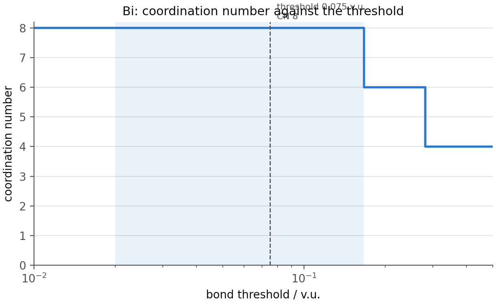
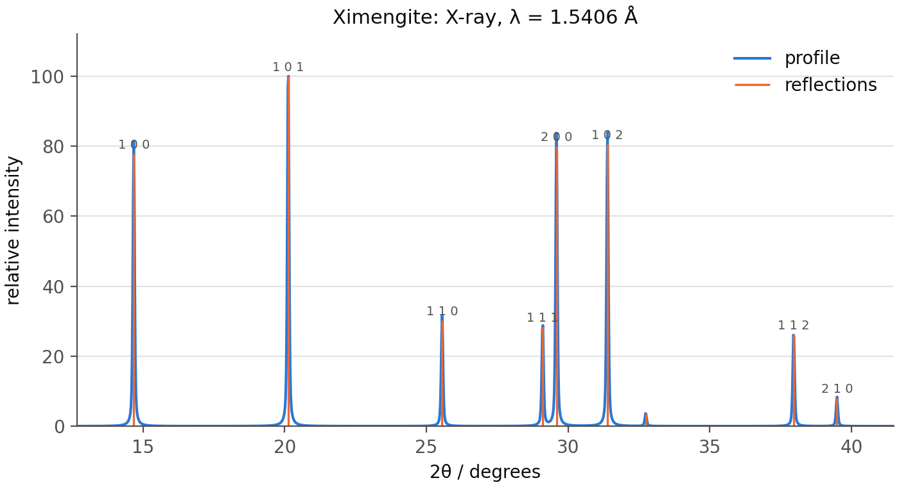
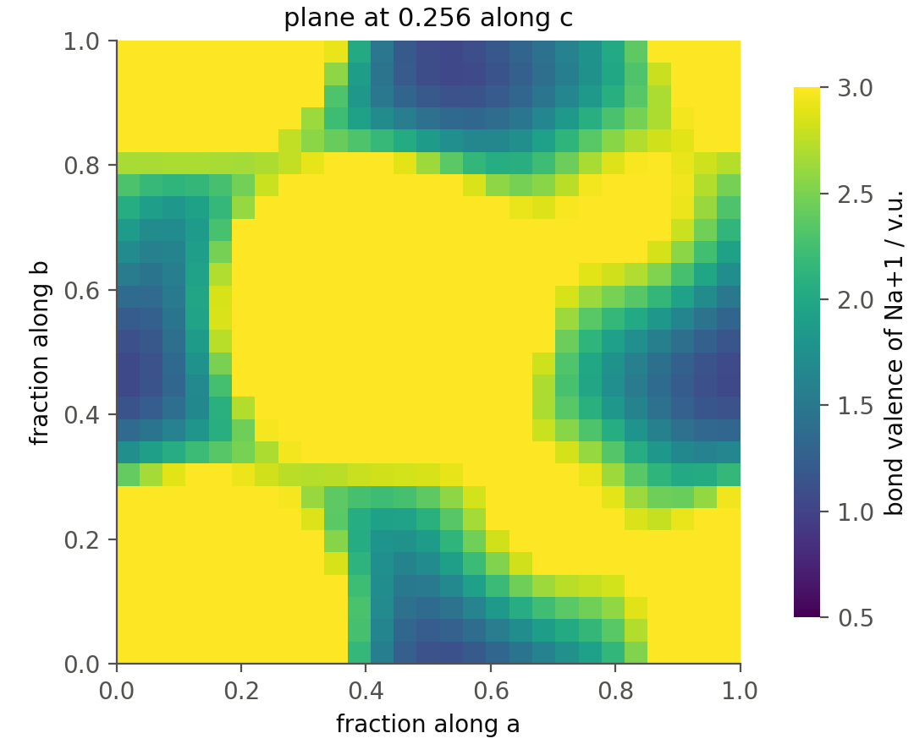
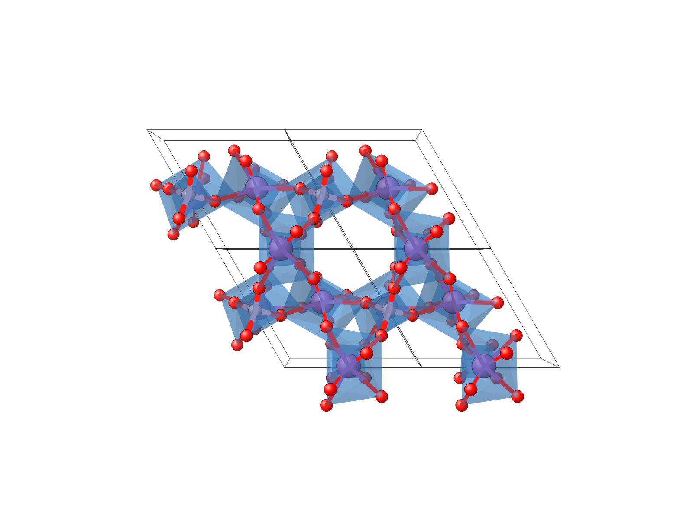
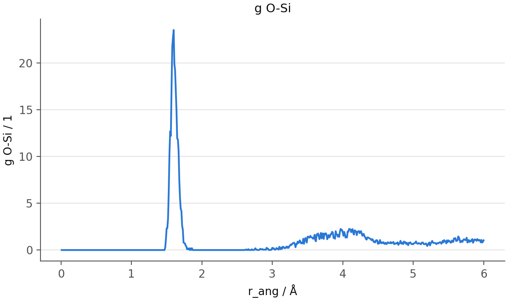
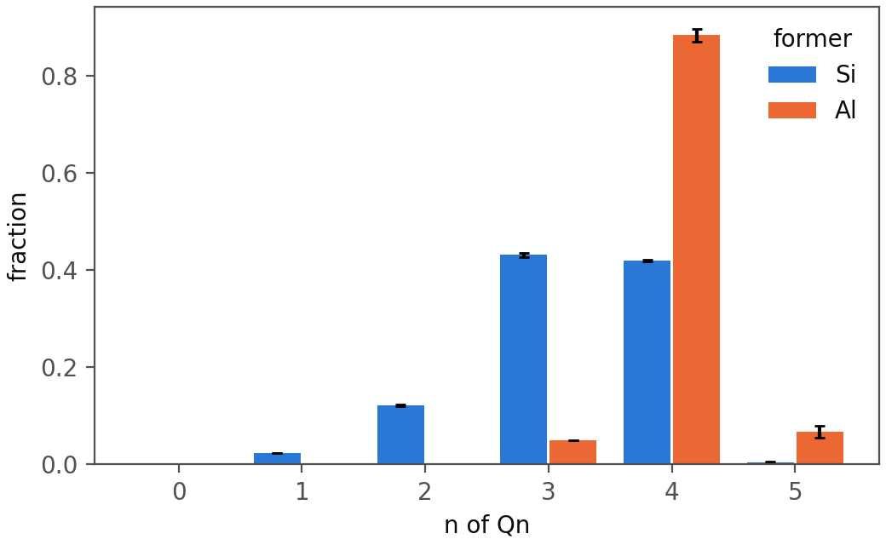

# FACET in your own Python code

A manual for the FACET library, version 2.1.0.

Everything the FACET window computes, called from a script or a notebook:
coordination numbers cut by bond valence, bond-valence sums, powder patterns
and pair distribution functions of crystal structures; Qn, oxygen speciation,
rings, g(r), S(Q) and diffusion of molecular-dynamics glass models; optical
basicity of both. Every example below was run to produce the output printed
under it.

## 1. Install and check

The library needs Python 3.11 or newer. It is the same package as the
application, installed from GitHub:

```python
python -m pip install "git+https://github.com/sams808/FACET"
python -m pip install pandas matplotlib openpyxl          # tables, figures, Excel files
```

The second line is optional: without pandas, matplotlib and openpyxl the
library still computes everything, and only `to_frame()`, the figures and the
`.xlsx` exports are unavailable. The FACET application installed from
`FACET-Setup.exe` carries its own private Python and cannot be imported from
a script; the `pip` installation above is separate and can live beside it.

To check an installation, and to see which version is in use:

```python
import facet

print(facet.__version__)
print(facet.selfcheck().title)
```

```text
2.1.0
90 of 90 checks within tolerance
```

`facet.selfcheck()` recomputes the numbers FACET's documentation states for
its bundled structures. From a terminal, `python -m facet --selfcheck` runs a
longer check that also opens the window.

To move to a newer version, repeat the first `pip` line with `--upgrade`.

## 2. A first look

Six crystal structures and one small glass model are bundled with FACET, so
every example in this manual runs as written. `facet.example(name)` opens
one; with a file of your own, `facet.read(path)` opens a crystal structure
and `facet.model(path)` a molecular-dynamics model.

```python
print(", ".join(facet.examples()))
```

```text
quartz, eulytite, senarmontite, valentinite, cryolite, bipo4, glass, glass-trajectory
```

A crystal structure, and the coordination of its cation sites:

```python
c = facet.example("eulytite")            # Bi4(SiO4)3
print(c)
print(c.sites().select("site", "ox", "CN", "BVS / v.u.", "phi", "plateau / decades"))
```

```text
<Crystal 'Eulytine' I -4 3 d: 3 sites, 76 atoms in the cell; v_bond 0.075 v.u.>
sites of Eulytine
site  ox  CN  BVS / v.u.  phi     plateau / decades
----  --  --  ----------  ------  -----------------
Bi    3   6   3.2404      0.4194  1.092
Si    4   4   4.0139      0       1.7005
note: bond threshold 0.075 v.u., listing threshold 0.02 v.u., parameters: Brese & O'Keeffe 1991
```

A glass model, and the Qn distribution of its silicon:

```python
m = facet.example("glass")               # 20Na2O-10CaO-5Al2O3-65SiO2, 1200 atoms
print(repr(m))
r = m.analyse("glass", formers=["Si", "Al"])
print(r.table("glass", "Qn Si (BV)").select("key", "mean (fraction)", "items per frame"))
```

```text
<Model 'practice_glass.data': 1200 atoms, 1 frame(s)>
glass: Qn Si (BV)
key  mean (fraction)  items per frame
---  ---------------  ---------------
0    0                260
1    0.0231           260
2    0.1231           260
3    0.4308           260
4    0.4192           260
5    0.0038           260
note: one frame: the spread across frames (std, ddof = 1) is undefined and given as NaN
```

Optical basicity of a composition:

```python
print(facet.basicity.composition("20Na2O-10CaO-5Al2O3-65SiO2").value)
```

```text
0.5935961013556568
```

The rest of the manual takes these three in turn: crystal structures
(section 4), glass models (section 5) and optical basicity (section 6), after
a section on what the results are.

## 3. What comes back

### Tables

Anything that is a list of rows comes back as a `Table`. A `Table` is a
Python list of dictionaries, one dictionary per row, and nothing else has to
be learned to use it:

```python
sites = c.sites()
print(type(sites[0]), len(sites))
print(sites[0]["site"], sites[0]["CN"], sites[0]["BVS / v.u."])
```

```text
<class 'dict'> 2
Bi 6 3.2403648509228815
```

It carries a few helpers for the usual next step. Column names state their
unit, so the name to type is the name that is printed.

```python
print(sites.columns[:9])
print(sites.column("BVS / v.u."))                 # one column as a numpy array
print(sites.where(element="Bi").select("site", "CN", "shortest bond / Å", "longest bond / Å"))
```

```text
['site', 'element', 'ox', 'Wyckoff', 'multiplicity', 'CN', 'CN listed', 'ECoN', 'BVS / v.u.']
[3.24036485 4.01386418]
sites of Eulytine
site  CN  shortest bond / Å  longest bond / Å
----  --  -----------------  ----------------
Bi    6   2.158              2.606
note: bond threshold 0.075 v.u., listing threshold 0.02 v.u., parameters: Brese & O'Keeffe 1991
```

| Helper | Gives |
|---|---|
| `table.columns` | the column names |
| `table.column(name)` | one column as a numpy array |
| `table.select(a, b, ...)` | the same rows with only these columns |
| `table.where(element="O")` | the rows whose column equals the value |
| `table.sorted_by(name, reverse=False)` | the rows in order |
| `table.head(n)` | the first rows |
| `table.to_frame()` | a pandas `DataFrame` |
| `table.to_csv(path)` | a CSV file, the notes as comment lines |
| `print(table)`, `table.text(notes=False)` | aligned text, with the title and the notes, or without the notes |
| `table.notes` | how the rows were produced: thresholds, parameters |

With pandas, a table becomes a data frame in one call, and everything pandas
does is then available:

```python
frame = c.sites(anions=True).to_frame()
print(frame.groupby("element")[["CN", "BVS / v.u."]].mean().round(3))
```

```text
          CN  BVS / v.u.
element
Bi       6.0       3.240
O        3.0       2.084
Si       4.0       4.014
```

In a Jupyter notebook a `Table` left as the last line of a cell is displayed
as a formatted table.

### The engine's own objects

A calculation that produces more than rows (a powder pattern, a pair
distribution function, a field over the cell, the analysis of one site)
returns the object the application itself works with. Each has plain
attributes, usually numpy arrays, and a `notes` list. The sections below name
the attributes worth knowing; `help(obj)` and `dir(obj)` show the rest.

### Notes

FACET does not grade its results. A number comes with the statements needed
to read it: which threshold, which parameter set, whether a bond-valence
parameter was estimated, what a file left unsaid. They are in `table.notes`,
`result.notes` and, for a model, in `print(model)`. Reading them is part of
using the library.

### Two thresholds

Most numbers below depend on two thresholds, both in valence units (v.u.):

- `v_bond` (default 0.075): a contact whose bond valence is above it counts
  as a bond. It replaces a distance cutoff, and it cuts every anion at the
  same bond strength instead of at a distance chosen for oxygen.
- `v_list` (default 0.02): contacts above it are kept in the tables, bonded
  or not.

The bond valence of a contact of length d is `exp((R0 - d) / b)`, with `R0`
and `b` from a table of bond-valence parameters (Brese and O'Keeffe 1991 by
default).

```python
print(facet.bond_valence(1.61, r0=1.624))         # a Si-O bond of 1.61 Å
print(facet.cutoff_distance(r0=1.624, v=0.075))   # the Si-O distance where v = 0.075
```

```text
1.0385628036326633
2.582398851214956
```

## 4. Crystal structures

### Reading a structure

`facet.read` takes CIF, VESTA, POSCAR and CONTCAR, SHELX (`.res`, `.ins`),
PDB, CrystalMaker text and XYZ files.

```python
c = facet.read("my_structure.cif")
c = facet.read("several.cif", block="phase_2")        # one data block of a CIF
all_of_them = facet.read_all("several.cif")           # every block, a list
c = facet.read("my_structure.cif", v_bond=0.10)       # another bond threshold
c = facet.read("my_structure.cif", params="bvparm2020")   # the IUCr parameter table
```

What was read:

```python
c = facet.example("bipo4")
print(c.name, "|", c.formula, "|", c.spacegroup)
print(c.cell.lengths, c.cell.angles, round(c.cell.volume, 2))
print(c.labels)
print(c.composition()["counts"], round(c.density()["density"], 3), "g/cm3")
```

```text
Ximengite | Bi O4 P | P 31 2 1
(6.966, 6.966, 6.46) (90.0, 90.0, 120.0) 271.48
['Bi', 'P', 'O1', 'O2']
{'Bi': 3.0, 'P': 3.0, 'O': 12.0} 5.578 g/cm3
```

`c.check()` lists what the reading of the file found worth stating
(occupancies, missing fields, very short contacts), `c.oxidation_states()`
the oxidation state given to each cation and where it came from, and
`c.atoms()` every atom of the cell with its coordinates.

### The sites

`c.sites()` has one row per cation site; `c.sites(anions=True)` adds the
anion sites.

```python
print(c.sites(anions=True).select("site", "ox", "multiplicity", "CN", "ECoN",
                                  "BVS / v.u.", "BVS - ox / v.u.", "phi"))
```

```text
sites of Ximengite
site  ox  multiplicity  CN  ECoN    BVS / v.u.  BVS - ox / v.u.  phi
----  --  ------------  --  ------  ----------  ---------------  ------
Bi    3   3             8   6.6471  3.0445      0.0445           0.1279
P     5   3             4   4       4.5095      -0.4905          0.0009
O1    -2  6             3   1.0003  1.8445      -0.1555          0.4009
O2    -2  6             3   1.0002  1.9325      -0.0675          0.3568
note: bond threshold 0.075 v.u., listing threshold 0.02 v.u., parameters: Brese & O'Keeffe 1991
```

| Column | Meaning |
|---|---|
| `CN` | contacts with a bond valence above `v_bond` |
| `CN listed` | contacts above `v_list` |
| `ECoN` | Hoppe's effective coordination number |
| `BVS / v.u.` | bond-valence sum over the bonds |
| `BVS - ox / v.u.` | the sum minus the oxidation state |
| `phi` | length of the bond-valence vector sum over the valence sum: 0 for a centred site, larger when the bonds lean to one side (a stereoactive lone pair) |
| `void half-angle / deg` | half-angle of the largest cone at the site holding no ligand |
| `plateau / decades` | width, in decades of threshold, of the range of `v_bond` over which `CN` does not change |
| `plateau from`, `plateau to` | the ends of that range |
| `estimated parameters` | True when a bond-valence parameter was estimated, not tabulated |

### One site

`c.site(label)` (or `c[label]`) is one site. Its most used numbers are
attributes:

```python
bi = c.site("Bi")
print(bi)
print(bi.cn, round(bi.bvs, 3), round(bi.phi, 3), round(bi.econ, 2), round(bi.void_angle, 1))
```

```text
Bi (Bi+3): CN 8 at 0.075 v.u., ECoN 6.65, BVS 3.04, phi 0.128, plateau 0.92 dec / 0.784 A
8 3.045 0.128 6.65 61.4
```

Every contact, nearest first:

```python
print(bi.contacts().select("neighbour", "distance / Å", "valence / v.u.", "bonded", "parameters"))
```

```text
contacts of Bi
neighbour  distance / Å  valence / v.u.  bonded  parameters
---------  ------------  --------------  ------  ----------
O1         2.311         0.5503          yes     fitted
O1         2.311         0.5502          yes     fitted
O2         2.329         0.5241          yes     fitted
O2         2.329         0.5241          yes     fitted
O2         2.5593        0.2813          yes     fitted
O2         2.5594        0.2812          yes     fitted
O1         2.753         0.1666          yes     fitted
O1         2.753         0.1666          yes     fitted
note: bonded: valence above 0.075 v.u.; listed: above 0.02 v.u.
```

The coordination number is a function of the threshold. `plateaus()` lists
every value it takes and over what range; the row that holds the threshold in
force is marked.

```python
print(bi.plateaus().select("CN", "from / v.u.", "to / v.u.", "width / decades",
                           "holds the bond threshold"))
```

```text
plateaus of Bi
CN  from / v.u.  to / v.u.  width / decades  holds the bond threshold
--  -----------  ---------  ---------------  ------------------------
1   0.5502       0.5503     5.652e-06        no
2   0.5241       0.5502     0.0211           no
3   0.5241       0.5241     2.150e-06        no
4   0.2813       0.5241     0.2703           no
5   0.2812       0.2813     4.449e-05        no
6   0.1666       0.2812     0.2273           no
7   0.1666       0.1666     4.428e-05        no
8   0.02         0.1666     0.9207           yes
```

Contacts that are equal by symmetry differ in their last digits, which is
where the plateaus of negligible width between them come from.

The same site at another threshold, without reading the file again:

```python
print(bi.cn_at(0.20), bi.at(0.20).cn, round(bi.at(0.20).bvs, 3))
```

```text
6 6 2.711
```

`bi.cn_function()` returns two arrays, thresholds and coordination numbers,
for a plot; `facet.plot.cn_function(bi)` draws it:

```python
facet.plot.cn_function(bi, save="cn_function.png")
```



More on one site:

```python
print(bi.angles().head(4))
print(bi.cn_methods().select("method", "CN", "note"))
```

```text
angles at Bi
ligand 1  ligand 2  angle / deg  d1 / Å  d2 / Å
--------  --------  -----------  ------  ------
O2        O1        57.115       2.5594  2.753
O2        O1        57.1158      2.5593  2.753
O2        O1        64.4519      2.329   2.753
O2        O1        64.4525      2.329   2.753
coordination number of Bi by method
method                 CN      note
---------------------  ------  ---------------------------------
Bond valence           8
Distance cutoff        8
Within % of shortest   8
Sum of covalent radii  6
Maximum gap (Brunner)  4       largest step d(k+1)/d(k) = 1.099
Maximum gap (1/d)      4
ECoN (Hoppe)           6.6471  weighted mean distance 2.4019 Å
CHARDI                 5.4068
Valence-weighted       5.5329
Voronoi (solid angle)  6.0526  8 facets above 20% of the largest
note: spread over the methods: n 10, min 4, max 8, range 4, median 6.03, mean 6.16, integer_values …
```

| Call | Gives |
|---|---|
| `site.contacts()` | every contact: distance, valence, bonded or not, parameters and their source |
| `site.plateaus()` | each coordination number and its range of threshold |
| `site.cn_function()` | arrays for the CN against the threshold |
| `site.cn_at(v)`, `site.at(v)` | the CN, or the whole site, at another threshold |
| `site.angles()` | every ligand-centre-ligand angle |
| `site.shells()` | contacts in the order a growing cutoff includes them, with running CN and valence sum |
| `site.cn_methods()` | the CN by ten definitions (ECoN, CHARDI, largest gap, Voronoi, ...) and their spread |
| `site.shape()` | distance statistics, polyhedron volume, distortion indices |
| `site.lone_pair()` | phi, the bond-valence vector, the empty cone |
| `site.radial_shells(r_max)` | neighbours of any kind grouped by distance |
| `site.exafs_shells(r_max)` | shells as an EXAFS fit takes them: N, R, sigma squared |
| `site.write_feff(path)` | a FEFF input with the site as absorber |
| `site.text("md")` | the site written out, as text, Markdown or LaTeX |
| `site.row()` | the site's row of `c.sites()`, as a dictionary |
| `site.result` | the engine's `SiteResult`, with everything |

### The structure as a whole

```python
print(c.cutoffs().select("pair", "R0 / Å", "bond cutoff / Å", "shortest / Å", "bonds"))
print(c.anion_sums().select("site", "expected / v.u.", "BVS / v.u.", "contacts"))
print(round(c.gii()["gii"], 3), "v.u., largest at", c.gii()["worst_site"])
```

```text
cutoffs of Ximengite
pair    R0 / Å  bond cutoff / Å  shortest / Å  bonds
------  ------  ---------------  ------------  -----
Bi3+–O  2.09    3.0484           2.311         8
P5+–O   1.604   2.5624           1.5595        4
note: bond threshold 0.075 v.u., listing threshold 0.02 v.u., parameters: Brese & O'Keeffe 1991
note: a cutoff distance is d = R0 - b ln(v); it is not chosen, it follows from the valence thresho …
anion valence sums of Ximengite
site  expected / v.u.  BVS / v.u.  contacts
----  ---------------  ----------  --------
O1    2                1.8445      3
O2    2                1.9325      3
note: bond threshold 0.075 v.u., listing threshold 0.02 v.u., parameters: Brese & O'Keeffe 1991
0.348 v.u., largest at P
```

| Call | Gives |
|---|---|
| `c.cutoffs()` | the distance each cation-anion pair is cut at, with `R0` and `b` |
| `c.anion_sums()` | the valence sum of every anion site |
| `c.charge_balance()` | cation and anion valence sums over the cell, and their difference |
| `c.gii()`, `c.bond_strain()` | global instability index, bond strain index |
| `c.a_priori()` | a priori bond valences of the bond network, and the two indices against the observed ones |
| `c.connectivity()` | which polyhedra share a corner, an edge or a face |
| `c.stability()` | the CN of every site over a range of thresholds |
| `c.with_thresholds(v_bond=..., v_list=..., params=...)` | the same structure analysed otherwise |

`c.stability()` returns an object with `thresholds`, `per_site[label]` (the CN
at each threshold) and `stable_range(label, at)`:

```python
scan = facet.example("cryolite").stability()
for label in scan.per_site:
    low, high = scan.stable_range(label, at=0.075)
    print(f"{label}: CN unchanged from {low:.3f} to {high:.3f} v.u.")
```

```text
Al: CN unchanged from 0.005 to 0.300 v.u.
Na1: CN unchanged from 0.005 to 0.193 v.u.
Na2: CN unchanged from 0.064 to 0.077 v.u.
```

### Diffraction, PDF and EXAFS

```python
pattern = c.diffraction(wavelength=1.5406, two_theta_max=40)     # radiation="neutron" for neutrons
lines = facet.table(pattern.reflections)
print(lines.select("h", "k", "l", "d", "two_theta", "intensity", "multiplicity").head(6))
x, y = pattern.profile(two_theta_min=10, two_theta_max=40)      # a broadened curve
print(x.shape, round(float(y.max()), 1))
```

```text
h  k  l  d       two_theta  intensity  multiplicity
-  -  -  ------  ---------  ---------  ------------
1  0  0  6.0327  14.6719    77.8438    6
1  0  1  4.4091  20.1232    100        12
1  1  0  3.483   25.5543    30.2318    6
1  1  1  3.0658  29.1039    28.3231    12
2  0  0  3.0164  29.5914    79.9477    6
1  0  2  2.8475  31.3898    80.4843    12
(1502,) 100.0
```

```python
facet.plot.pattern(pattern, save="pattern.png")
```



`c.d_spacing(h, k, l)` and `c.two_theta(h, k, l, wavelength)` give one
reflection; `c.reflections()` lists positions without intensities.

The pair distribution function comes back with its arrays and with every
assumption it made:

```python
g = c.pdf(r_max=10.0, radiation="X-ray")
print(g.r.shape, g.G.shape)                # also g.g and g.R
for note in g.notes[:3]:
    print("-", note)
```

```text
(1000,) (1000,)
- X-ray weights at Q = 0; the pair weights are Bi-Bi 40.7%, Bi-O 31.4%, Bi-P 14.7%, O-O 6.1%, O-P  …
- rho0 = 0.06630 atoms/A^3 from 18 atoms per cell, occupancies included.
- All 18 atoms took U from the file.
```

Options of `c.pdf`: `dr`, `u_iso`, `q_min`, `q_max`, `q_damp`, `q_broad`,
`delta1`, `delta2`. `facet.plot.pdf(g)` draws it.

For EXAFS, the shells about an absorber and a FEFF input:

```python
shells = facet.table(bi.exafs_shells(r_max=4.0).shells)
print(shells.select("element", "count", "r_mean", "sigma2_einstein"))
```

```text
element  count  r_mean  sigma2_einstein
-------  -----  ------  ---------------
O        4      2.32    0.0048
O        2      2.5594  0.0048
O        2      2.753   0.0048
P        2      3.23    0.0026
P        4      3.6686  0.0026
O        2      3.9052  0.0048
O        2      3.9908  0.0048
```

### Planes, maps and basicity

```python
plane = c.plane(1, 0, 1)
print(plane, plane.occupancy(tolerance=0.3), round(plane.angle_to(0, 0, 1), 2))
```

```text
<Plane (1 0 1) d = 4.4091 Å> {'Bi': 1.0, 'O': 2.0} 46.96
```

A valence map is the bond-valence sum a probe ion would have at every point
of the cell; where it equals the ion's charge, the ion would be correctly
bonded. It is used to look for the sites and the pathways of a mobile ion.

```python
cryolite = facet.example("cryolite")
grid = cryolite.valence_map("Na", resolution=0.2)
print(grid.shape, round(grid.statistics()["min"], 3))
print(grid.at_fractional([0.0, 0.0, 0.5]))          # the value at one point
facet.plot.grid(grid, "c", 0.25, levels=(0.5, 3.0), save="valence_map.png")
```

```text
(27, 28, 39) 1.04
[1.29842761]
```



`c.energy_map(element)` turns the map into an energy-like landscape, and
`facet.read_volume(path)` reads a CHGCAR, a Gaussian cube or an XSF file into
the same kind of grid.

`c.basicity()` gives the optical basicity of the structure (section 6).

### Writing files and pictures

```python
c.write("bipo4.cif")                     # also .vasp (POSCAR), .xyz, .vesta
c.render("bipo4.png", style="polyhedral", along="c", cell_range=(2, 2, 1))
```



`c.render` draws the structure as the application does and writes a PNG, an
SVG or a PDF. `style` is one of `ball-and-stick`, `polyhedral`,
`space-filling`, `stick`, `wireframe`, `displacement ellipsoids`; `polyhedra`
is `True`, `False` or a list of site labels; `along` is `a`, `b`, `c`, `a*`,
`b*`, `c*` or a vector.

### Several structures

`facet.compare` puts the cation sites of several structures in one table,
and `facet.report_on` writes the full report of the application (sites,
contacts, plateaus, cutoffs, charge balance, basicity) to an Excel, CSV,
HTML, Markdown, LaTeX or JSON file.

```python
files = [facet.examples()[name] for name in ("senarmontite", "valentinite")]
both = facet.compare(files)                           # the two forms of Sb2O3
print(both.select("structure", "site", "CN", "BVS / v.u.", "phi", "plateau / decades"))
report = facet.report_on(files, "sb2o3.xlsx")
print({name: len(rows) for name, rows in report.tables().items()})
```

```text
sites of several structures
structure     site  CN  BVS / v.u.  phi     plateau / decades
------------  ----  --  ----------  ------  -----------------
Senarmontite  Sb    6   3.2035      0.4604  0.6082
Valentinite   Sb    5   3.1503      0.4874  0.9412
{'sites': 2, 'contacts': 11, 'plateaus': 9, 'cutoffs': 2, 'balance': 2, 'basicity': 5}
```

Both take a folder as well as a list of files.

## 5. Glass models from molecular dynamics

### Opening a model

`facet.model` reads LAMMPS data files and dumps, extended XYZ, DL_POLY
(CONFIG, REVCON, HISTORY), VASP (POSCAR, XDATCAR), GROMACS, CP2K and other
trajectory formats, with one frame or many. A LAMMPS file numbers its atom
types and does not name them, so the elements are given as a `type_map`:

```python
path = facet.examples()["glass"]                 # a LAMMPS data file
m = facet.model(path, type_map={1: "O", 2: "Si", 3: "Al", 4: "Na", 5: "Ca"})
for line in m.describe()[2:10]:
    print(line)
```

```text
1200 atoms per frame; 1 readable frame(s)
timesteps 10000 to 10000
no frame times in the file
box (frame 0): a 24.9422, b 24.9422, c 24.9422 Å; alpha 90, beta 90, gamma 90 deg; volume 15516.8  …
number density (frame 0) 0.0773356 atoms/Å^3
composition (frame 0): Al 40, Ca 40, Na 160, O 700, Si 260
the box is the same in every frame
type map (user): 1 -> O, 2 -> Si, 3 -> Al, 4 -> Na, 5 -> Ca
```

When the `Masses` section holds the elements' own masses, FACET names the
types from them and the `type_map` can be left out; a mass written short
(22.9 for sodium) is not recognised, and the reader then asks for the map.

`print(m)` gives the whole statement of what was read and what was assumed
(units, charges, box). It is worth reading once for every new kind of file.

```python
print(m.n_atoms, m.n_frames, m.composition())
print(round(m.density(), 3), "g/cm3")
print(m.oxidation_states())
```

```text
1200 1 {'Al': 40, 'Ca': 40, 'Na': 160, 'O': 700, 'Si': 260}
2.661 g/cm3
{'Al': 3, 'Ca': 2, 'Na': 1, 'O': -2, 'Si': 4}
```

The oxidation states are the usual ones of each element. An element in
another state is given where it is used: `ox={"Fe": 2}`.

`m.frame(k)` is one frame (`k` from 0, negative from the end) with its arrays:
`elements`, `cart_ang` (positions in Å), `frac`, `box_ang`, and `time_ps`
when the file states it.

A model keeps its file open, so that a long trajectory is read frame by frame
and not at once. `m.close()` closes it; in a loop over many files, `with
facet.model(path) as m:` closes each at the end of its block (the last
recipe of section 8).

### The analyses

`facet.analyses()` lists every analysis a model can be given, with what each
measures and what it needs:

```python
print(facet.analyses().select("analysis", "runs", "needs"))
```

```text
analyses of an MD model
analysis                runs              needs
----------------------  ----------------  -------------------------------------------------------- …
glass                   per frame         formers
basicity                per frame
scattering              per frame         scattering.r_window, scattering.radiations
rings                   per frame         formers, network.ring_criterion, network.ring_max_size
coordination-sequences  per frame         formers, network.n_shells
polyhedral-sharing      per frame         formers
components              per frame         formers
warren-cowley           per frame
bond-order              per frame
tetrahedral-order       per frame
polyhedron-shape        per frame
voronoi                 per frame
empty-spheres           per frame         voids.radii
free-volume             per frame         voids.grid_spacing_ang, voids.probe_radius_ang, voids.ra …
channels                per frame         channels.delta_vu, channels.deltas_vu, channels.probe
modifier-density        per frame         channels.k_rich, channels.modifiers
void-regions            per frame         channels.void_probe_radius_ang, voids.radii
nmr                     per frame         nmr.correlation, nmr.delta_ppm, nmr.fwhm_ppm, nmr.linesh …
exafs                   per frame         exafs.absorber
bond-lifetimes          per frame         a time axis (timestep_fs or frame_interval_ps) and two f …
msd                     whole trajectory  a time axis (timestep_fs or frame_interval_ps) and two f …
self-correlations       whole trajectory  dynamics.lag_t_ps, a time axis (timestep_fs or frame_int …
distinct-van-hove       whole trajectory  dynamics.distinct_n_origins, dynamics.distinct_pairs, dy …
vacf                    whole trajectory  a time axis (timestep_fs or frame_interval_ps) and two f …
kinetic-temperature     whole trajectory  a time axis (timestep_fs or frame_interval_ps) and two f …
conductivity            whole trajectory  charges_e, dynamics.fit_t_min_ps/fit_t_max_ps, temperatu …
nmr-comparison          after the others  nmr.measured_fractions
scattering-comparison   after the others  scattering.measured, scattering.r_window, scattering.rad …
feff                    after the others  exafs.absorber, feff.cluster_radius_ang, feff.edge, feff …
```

### Running an analysis

`m.analyse(names..., inputs...)` runs analyses and returns their results.
The `glass` analysis is the main one: coordination numbers by bond valence
and by distance, oxygen speciation, Qn, bond angles and lengths, partial g(r).
It needs the network formers.

```python
r = m.analyse("glass", formers=["Si", "Al"])
print(r)
print(r.descriptors().where(kind="distribution").select("descriptor", "rows").head(14))
```

```text
<Results of glass: 176 descriptor(s)>
descriptors measured
descriptor                   rows
---------------------------  ----
CN Al (BV)                   2
Al CN (4, 5, 6, other) (BV)  4
CN Ca (BV)                   5
CN Na (BV)                   6
CN O (BV)                    5
CN Si (BV)                   2
O speciation (BV)            4
Qn Al (BV)                   6
Qn Si (BV)                   6
Qn(mAl) Al (BV)              7
Qn(mAl) Si (BV)              13
Qn(mSi) Al (BV)              8
Qn(mSi) Si (BV)              12
O linkages (BV)              10
```

Each line is a *descriptor*: one table of one analysis. `(BV)` marks a
descriptor counted with the bond-valence threshold, `(distance)` the same
counted with a distance cutoff at the first minimum of g(r); both are
always given. `r.find(text)` searches the names, and `r.table(analysis,
descriptor)` returns one as rows:

```python
print(r.table("glass", "O speciation (BV)").select("key", "mean (fraction)", "items per frame"))
print(r.table("glass", "Al CN (4, 5, 6, other) (BV)").select("key", "mean (fraction)"))
print(r.table("glass", "mean CN Na (BV)").select("descriptor", "mean (1)"))
print(r.table("glass", "distance cutoffs").select("pair", "cutoff (Å)"))
```

```text
glass: O speciation (BV)
key         mean (fraction)  items per frame
----------  ---------------  ---------------
free        0.0014           700
NBO         0.28             700
BO          0.7157           700
tricluster  0.0029           700
note: one frame: the spread across frames (std, ddof = 1) is undefined and given as NaN
glass: Al CN (4, 5, 6, other) (BV)
key    mean (fraction)
-----  ---------------
Al4    0.925
Al5    0.075
Al6    0
other  0
note: one frame: the spread across frames (std, ddof = 1) is undefined and given as NaN
glass: mean CN Na (BV)
descriptor  mean (1)
----------  --------
mean CN Na  4.2
note: one frame: the spread across frames (std, ddof = 1) is undefined and given as NaN
glass: distance cutoffs
pair  cutoff (Å)
----  ----------
Al-O  2.88
Ca-O  3.38
Na-O  3.46
Si-O  2.48
```

A curve, such as a partial g(r), is a container with its arrays:

```python
g = r.get("glass", "g O-Si")
print(type(g).__name__, g.axis_name, g.axis_unit, g.axis.shape, g.mean.shape)
peak = g.axis[g.mean.argmax()]
print(f"first Si-O peak at {peak:.2f} Å")
facet.plot.descriptor(r, "glass", "g O-Si", save="g_si_o.png")
```

```text
Series r_ang Å (600,) (600,)
first Si-O peak at 1.60 Å
```



What the run states about the model and about itself is in `r.notes`, the
full provenance (file, frames, thresholds, cutoffs, every method parameter)
in `r.provenance`, and `r.export` writes everything:

```python
written = r.export("glass.xlsx")                 # one sheet per descriptor
files = r.export("glass_csv")                    # or one CSV per descriptor
print(written[0].name, len(files), "CSV files")
```

```text
glass.xlsx 179 CSV files
```

### Several frames

With a trajectory, each descriptor is the mean over the frames with its
spread, and `per_frame=True` adds the frames one by one.

```python
t = facet.example("glass-trajectory")            # six frames, 2 ps apart
print(repr(t))
rt = t.analyse("glass", formers=["Si", "Al"])
print(rt.table("glass", "Qn Si (BV)").select("key", "mean (fraction)", "std (fraction)", "frames used"))
qn = rt.table("glass", "Qn Si (BV)", per_frame=True)       # one more column per frame
print(qn.select("key", "frame 0 (fraction)", "frame 2 (fraction)", "frame 5 (fraction)"))
```

```text
<Model 'practice_glass.lammpstrj.gz': 1200 atoms, 6 frame(s)>
glass: Qn Si (BV)
key  mean (fraction)  std (fraction)  frames used
---  ---------------  --------------  -----------
0    0                0               6
1    0.0231           0               6
2    0.1218           0.002           6
3    0.4308           0.0042          6
4    0.4199           0.0016          6
5    0.0045           0.0016          6
glass: Qn Si (BV)
key  frame 0 (fraction)  frame 2 (fraction)  frame 5 (fraction)
---  ------------------  ------------------  ------------------
0    0                   0                   0
1    0.0231              0.0231              0.0231
2    0.1192              0.1231              0.1231
3    0.4346              0.4308              0.4308
4    0.4192              0.4192              0.4192
5    0.0038              0.0038              0.0038
```

`frames` chooses the frames: `frames="0:100:5"` (start, stop, step), a
`slice`, or a list of indices. Opening a trajectory reads nothing until a
frame is needed, so a long file costs only the frames used.

### Inputs, options and what is missing

An analysis that lacks an input says which before any frame is read:

```python
for line in m.missing("rings", "scattering"):
    print("-", line[:96])
```

```text
- rings: formers: the network formers (cation elements, e.g. Si,B); the 'bridging anion' graph and
- scattering: scattering.r_window: 'none' or 'Lorch', the M(r) of the sine transform; it changes S
- scattering: scattering.radiations: one or more of X-ray, neutron, electron
- rings: network.ring_criterion: king, guttman or primitive: the definition of a ring
- rings: network.ring_max_size: the largest ring searched, in graph nodes; the cost grows with it
```

The inputs are keywords of `analyse`. The top-level ones are `formers`,
`frames`, `ox`, `v_bond`, `v_list`, `timestep_fs` or `frame_interval_ps`,
`temperature_k`, `charges_e` and `workers`. The others are grouped by topic,
each group a dictionary: `glass`, `scattering`, `network`, `order`, `voids`,
`channels`, `nmr`, `exafs`, `dynamics`, `basicity`.

```python
r2 = m.analyse("rings", "scattering", formers=["Si", "Al"],
               network={"ring_criterion": "king", "ring_max_size": 10},
               scattering={"radiations": ["X-ray", "neutron"], "r_window": "Lorch"})
print(r2.descriptors("rings").select("descriptor", "kind"))
sizes = r2.table("rings", "ring sizes (T atoms: Al, Si), king").select("key", "mean (fraction)")
print(sizes.text(notes=False))
print(len(sizes.notes), "notes, the first:", sizes.notes[0][:60], "...")
s = r2.get("scattering", "S(Q) neutron")
print(s.axis_name, s.axis_unit, s.axis[:3], s.mean[:3].round(3))
```

```text
descriptors measured
descriptor                            kind
------------------------------------  ------------
R_C(n), king rings                    series
R_N(n), king rings                    series
P_N(n), king rings                    series
P_max(n), king rings                  series
P_min(n), king rings                  series
distinct rings by size (nodes), king  distribution
ring sizes (nodes), king              distribution
ring sizes (T atoms: Al, Si), king    distribution
rings: ring sizes (T atoms: Al, Si), king
key  mean (fraction)
---  ---------------
3    0.0037
4    0.0618
5    0.1292
6    0.161
7    0.2004
8    0.2079
9    0.1273
10   0.1086
10 notes, the first: graph: bridging anion: formers Al, Si linked through a share ...
q_inv_ang 1/Å [0.02 0.04 0.06] [0.102 0.102 0.102]
```

`print(facet.options())` lists every option of every group with its type and
default, and a wrong name or value is refused with the list of the valid
ones. `m.preset(name)` gives the analyses and options of one of the
questions the application offers as presets (`facet.presets()` lists them):

```python
p = m.preset("Aluminosilicate")
print(p["analyses"])
print(p["formers"], p["network"], p["voids"])
```

```text
['glass', 'basicity', 'rings', 'polyhedral-sharing', 'components', 'bond-order', 'polyhedron-shape …
['Al', 'Si'] {'ring_criterion': 'king', 'ring_max_size': '12'} {'radii': 'vdw'}
```

### Dynamics

The analyses of time (`msd`, `vacf`, `bond-lifetimes`, `conductivity`, the
van Hove functions) need more than one frame and a time axis. When the file
does not state its frame times, the time between frames is given:

```python
rd = t.analyse("msd", frame_interval_ps=2.0)
print(rd.descriptors().select("descriptor", "kind", "rows").head(8))
```

```text
descriptors measured
descriptor                 kind    rows
-------------------------  ------  ----
MSD Al                     series  6
MSD Ca                     series  6
MSD Na                     series  6
MSD O                      series  6
MSD Si                     series  6
MSD of the centre of mass  series  6
```

The practice trajectory is six frames of a glass at 300 K, where nothing
diffuses; a diffusion coefficient needs a long run of a melt and the fit
window `dynamics={"fit_t_min_ps": ..., "fit_t_max_ps": ...}`.

### Atom by atom

`m.atoms()` gives every atom of a frame with what FACET measures on a site:

```python
atoms = m.atoms()
print(atoms.head(4).select("atom", "element", "CN", "BVS / v.u.", "phi", "plateau / decades"))
frame = atoms.to_frame()
print(frame.groupby("element")[["CN", "BVS / v.u.", "phi"]].mean().round(3))
```

```text
atoms of practice_glass.data, frame 0
atom  element  CN  BVS / v.u.  phi     plateau / decades
----  -------  --  ----------  ------  -----------------
1     Si       4   3.992       0.0639  1.5955
2     Si       4   4.1094      0.0753  1.6147
3     O        2   1.9244      0.3545  1.5756
4     Na       4   0.5967      0.4191  0.5149
note: bond threshold 0.075 v.u., listing threshold 0.02 v.u.
            CN  BVS / v.u.    phi
element
Al       4.075       3.134  0.072
Ca       5.475       1.642  0.152
Na       4.200       0.845  0.288
O        2.993       2.011  0.313
Si       4.004       4.159  0.062
```

One atom can be read exactly as a site of a crystal (section 4): its
contacts, plateaus, angles, CN function and CN by other methods.

```python
number = atoms.where(element="Al")[0]["atom"]
al = m.site(number)
print(al)
print(al.contacts().select("neighbour", "distance / Å", "valence / v.u.", "bonded"))
```

```text
Al6 (Al+3): CN 4 at 0.075 v.u., ECoN 3.84, BVS 3.32, phi 0.067, plateau 1.49 dec / 1.269 A
contacts of Al6
neighbour  distance / Å  valence / v.u.  bonded
---------  ------------  --------------  ------
O553       1.6651        0.9627          yes
O1167      1.6971        0.8829          yes
O252       1.7097        0.8534          yes
O890       1.8295        0.6172          yes
note: bonded: valence above 0.075 v.u.; listed: above 0.02 v.u.
```

| Call | Gives |
|---|---|
| `m.atoms(k)` | every atom: CN, valence sum, phi, plateau width |
| `m.site(atom, k)` | one atom as a site |
| `m.environments(element, formers=...)` | the environments of an element grouped by likeness: (groups, per atom) |
| `m.write_environment(atom, path, shells=2)` | the atom and its neighbours out to `shells` bonds, as an XYZ file |
| `m.density_map(elements, grid, sigma)` | smoothed number density of some elements over the box |
| `m.basicity(formers=...)` | optical basicity of the frame (section 6) |
| `m.parity(table_path, ...)` | another code's per-atom table beside FACET's values |

## 6. Optical basicity

Optical basicity has its own part of the library, `facet.basicity`, with its
own reference (`docs/basicity_library.md`). The three entry points:

```python
fb = facet.basicity
comp = fb.composition("20Na2O-10CaO-5Al2O3-65SiO2")        # moles; unit="wt" for weights
print(round(comp.value, 4), round(comp.polarisability, 3), round(comp.band("Pb2+")))

quartz = facet.example("quartz").basicity()                # a crystal: lambda per anion site
print(round(quartz.bulk, 4), round(quartz.value, 4))

glass = m.basicity(formers=["Si", "Al"])                   # a model frame: lambda per atom
print(round(glass.bulk, 4), round(glass.value, 4))
print(fb.text_table(("anion", "class", "atoms", "mean", "sd", "low", "high"), glass.by_class()))
```

```text
0.5936 1.551 42299
0.4775 0.4544
0.5936 0.574
anion  class       atoms  mean   sd     low    high
-----  ----------  -----  -----  -----  -----  -----
O      free        1      1.051  0.000  1.051  1.051
O      NBO         196    0.726  0.039  0.621  0.884
O      BO          501    0.514  0.064  0.380  0.716
O      tricluster  2      0.516  0.052  0.465  0.568
```

`comp.value` is Λ from the composition alone (Duffy and Ingram); the
`value` of a structure or a frame is the mean of the microscopic λ of its
anions, each from the bond valences it receives. `glass.values` is λ per
atom, `glass.linkages()` groups the anions by what they are bonded to, and
`glass.field("Na")` maps what a probe cation would sense. The scale of
basicity moderating parameters is an argument (`scale="duffy"`).

## 7. Figures

The quick figures are for a first look. Each returns the matplotlib figure;
`save="name.png"` (or `.pdf`, `.svg`) writes it and `show=True` opens a
window.

| Call | Draws |
|---|---|
| `facet.plot.cn_function(site)` | the CN of a site against the threshold |
| `facet.plot.contacts(site)` | bond valence against distance for every contact |
| `facet.plot.stability(crystal)` | the CN of every site against the threshold |
| `facet.plot.pattern(pattern)` | a powder pattern, lines and profile |
| `facet.plot.pdf(pdf, which="G")` | a pair distribution function |
| `facet.plot.grid(grid, "c", 0.5)` | one plane of a map |
| `facet.plot.descriptor(results, analysis, name)` | one descriptor of a model: bars, steps or a curve with its spread |
| `facet.basicity.plot.histogram(frame_result)` and others | the basicity figures |

For a figure of one's own, every number is in the objects. The Qn
distributions of the two formers of the practice glass, side by side:

```python
import matplotlib
matplotlib.use("Agg")
import matplotlib.pyplot as plt

fig, ax = plt.subplots(figsize=(5.2, 3.2), layout="constrained")
for shift, former, colour in ((-0.2, "Si", "#2a78d6"), (0.2, "Al", "#eb6834")):
    table = rt.table("glass", f"Qn {former} (BV)")
    n = table.column("key")
    ax.bar(n + shift, table.column("mean (fraction)"), width=0.38, color=colour,
           yerr=table.column("std (fraction)"), capsize=2, label=former)
ax.set_xlabel("n of Qn")
ax.set_ylabel("fraction")
ax.legend(frameon=False, title="former")
fig.savefig("qn.png", dpi=200)
```



## 8. Recipes

Each recipe runs as written on the bundled files. With files of your own,
replace the list of paths, for instance by `sorted(Path("my_folder").glob("*.cif"))`.

### A table of one element's sites over many structures

```python
import pandas as pd

rows = []
for name in ("eulytite", "bipo4"):
    crystal = facet.example(name)                       # facet.read(path) for a file
    for row in crystal.sites().where(element="Bi"):
        rows.append({"structure": crystal.name, **row})
bi = pd.DataFrame(rows)[["structure", "site", "CN", "BVS / v.u.", "phi", "plateau / decades"]]
print(bi.round(3).to_string(index=False))
bi.to_csv("bi_sites.csv", index=False)
```

```text
structure site  CN  BVS / v.u.   phi  plateau / decades
 Eulytine   Bi   6       3.240 0.419              1.092
Ximengite   Bi   8       3.045 0.128              0.921
```

### Optical basicity along a composition series

```python
series = []
for x in (0, 5, 10, 15, 20):
    text = f"{20 - x}Na2O-{10 + x}CaO-5Al2O3-65SiO2"
    found = facet.basicity.composition(text)
    series.append({"composition": text, "Lambda": round(found.value, 4),
                   "alpha(O2-) / Å3": round(found.polarisability, 3)})
print(facet.Table(series))
```

```text
composition                 Lambda  alpha(O2-) / Å3
--------------------------  ------  ---------------
20Na2O-10CaO-5Al2O3-65SiO2  0.5936  1.551
15Na2O-15CaO-5Al2O3-65SiO2  0.5892  1.545
10Na2O-20CaO-5Al2O3-65SiO2  0.5847  1.539
5Na2O-25CaO-5Al2O3-65SiO2   0.5803  1.533
0Na2O-30CaO-5Al2O3-65SiO2   0.5759  1.526
```

### Qn of every frame of a trajectory

```python
per_frame = rt.table("glass", "Qn Si (BV)", per_frame=True).to_frame().set_index("key")
frames = per_frame[[c for c in per_frame.columns if c.startswith("frame ")]].T
frames.index = [int(name.split()[1]) for name in frames.index]       # "frame 3 (fraction)" -> 3
frames.index.name = "frame"
print(frames.round(3).to_string())
```

```text
key      0      1      2      3      4      5
frame
0      0.0  0.023  0.119  0.435  0.419  0.004
1      0.0  0.023  0.123  0.431  0.419  0.004
2      0.0  0.023  0.123  0.431  0.419  0.004
3      0.0  0.023  0.123  0.423  0.423  0.008
4      0.0  0.023  0.119  0.435  0.419  0.004
5      0.0  0.023  0.123  0.431  0.419  0.004
```

### A per-atom file for OVITO or a spreadsheet

```python
atoms = m.atoms().to_frame()
atoms["lambda"] = m.basicity(formers=["Si", "Al"]).values        # NaN for the cations
atoms.to_csv("atoms.csv", index=False)
print(atoms[["atom", "element", "CN", "BVS / v.u.", "lambda"]].head(4).round(3).to_string(index=False))
```

```text
 atom element  CN  BVS / v.u.  lambda
    1      Si   4       3.992     NaN
    2      Si   4       4.109     NaN
    3       O   2       1.924   0.497
    4      Na   4       0.597     NaN
```

### Several models, one table

```python
from pathlib import Path

rows = []
for path in sorted(Path("runs").glob("*.data")):
    with facet.model(path, type_map={1: "O", 2: "Si", 3: "Na"}) as model:
        results = model.analyse("glass", formers=["Si"])
        for row in results.table("glass", "Qn Si (BV)"):
            rows.append({"model": path.stem, "n": row["key"], "fraction": row["mean (fraction)"]})
table = pd.DataFrame(rows).pivot(index="model", columns="n", values="fraction")
```

## 9. When something goes wrong

| What is printed | What it means, and what to do |
|---|---|
| `... type_map ...` when opening a LAMMPS file | the file numbers its atom types; give `type_map={1: "O", 2: "Si", ...}` in the order of the `Masses` section |
| `... is an MD model, not a crystal structure` | the file was given to `facet.read`; open it with `facet.model` |
| `rings: formers: ...` or another `analysis: input: ...` line | the analysis lacks an input; `m.missing(...)` lists them all, and each is a keyword of `analyse` |
| `unknown option ...` or `... is not one of ...` | a name or a value is misspelt; the message lists the valid ones, and `print(facet.options())` all of them |
| `no site labelled ...` | the label is not in the file; `c.labels` lists the labels |
| a note that a parameter was *estimated* | no tabulated bond-valence parameter covers the pair; the valence sums of that site rest on an estimate, and the note names the pair |
| a note that the model *is not neutral* | the atom counts and the oxidation states do not balance; the count of one element is usually the cause |
| `nan` in a table | the quantity is undefined there: a spread over one frame, a plateau width exactly on a step, λ of a cation |
| `to_frame() needs pandas`, `the figures need matplotlib` | the optional package is not installed (section 1) |
| a different number from the application | the thresholds or the parameter set differ; `table.notes` and `r.provenance` state those used |

A calculation that cannot be done is refused with the reason. It is not
replaced by an approximate one.

## 10. Reporting results

The numbers depend on choices, and a result is reproducible when they are
stated with it:

- the FACET version (`facet.__version__`);
- the bond threshold and the listing threshold, in valence units;
- the bond-valence parameter set (`c.params.name`, or the note of any table);
- for a model: the formers, the frames used, and whether a quantity is the
  bond-valence count or the distance count;
- for optical basicity: the scale.

`table.notes`, `results.provenance` and the header of every exported file
carry them. The references behind the main quantities:

- Bond valence: I. D. Brown and D. Altermatt, Acta Cryst. B41 (1985) 244;
  N. E. Brese and M. O'Keeffe, Acta Cryst. B47 (1991) 192.
- Effective coordination number: R. Hoppe, Z. Kristallogr. 150 (1979) 23.
- Optical basicity: J. A. Duffy and M. D. Ingram, J. Non-Cryst. Solids 21
  (1976) 373; J. A. Duffy, J. Non-Cryst. Solids 109 (1989) 35.
- The practice glass: interatomic potential of A. Pedone et al., J. Phys.
  Chem. B 110 (2006) 11780. It is a small, quickly quenched model for trying
  the library, and its input files are in `docs/practice_glass`.

## 11. Reference

### Functions of `facet`

| Call | Returns |
|---|---|
| `facet.read(path, block=None, v_bond=, v_list=, params=)` | a `Crystal` |
| `facet.read_all(path)` | a list of `Crystal`, one per data block |
| `facet.model(path, type_map=..., **reader_options)` | a `Model` |
| `facet.load(path)` | a `Model` or a `Crystal`, by what the file is |
| `facet.example(name)`, `facet.examples()` | a bundled file opened; the names and paths |
| `facet.compare(paths_or_crystals)` | one table of the cation sites of several structures |
| `facet.report_on(paths, out=None, fmt=None, ...)` | the report over several structures, written when `out` is given |
| `facet.analyses()`, `facet.presets()`, `facet.options()` | the analyses of a model, the presets, every option |
| `facet.parameters(name)` | a bond-valence parameter set: `"built-in"`, `"bvparm2020"` or a file |
| `facet.bond_valence(d, r0, b=0.37)`, `facet.cutoff_distance(r0, v, b=0.37)` | the bond-valence formula and its inverse |
| `facet.read_volume(path)` | a grid from a CHGCAR, cube or XSF file |
| `facet.table(objects)`, `facet.Table(rows)` | a table from the engine's objects, or from rows |
| `facet.selfcheck()` | the reference numbers recomputed |
| `facet.basicity`, `facet.plot` | optical basicity; the quick figures |

### A `Crystal`

| | |
|---|---|
| Identity | `name`, `formula`, `spacegroup`, `cell`, `labels`, `n_sites`, `n_atoms`, `notes`, `structure` |
| Thresholds | `v_bond`, `v_list`, `params`, `with_thresholds(...)` |
| Sites | `sites(anions=False)`, `site(label)`, `results(anions=False)`, `atoms()` |
| File | `composition()`, `density()`, `reciprocal_cell()`, `check()`, `oxidation_states()`, `disorder()`, `configuration(choices)` |
| Bond valence | `cutoffs()`, `anion_sums()`, `charge_balance()`, `gii()`, `bond_strain()`, `a_priori()`, `connectivity()`, `stability()` |
| Simulation | `diffraction(...)`, `reflections(...)`, `d_spacing(h, k, l)`, `two_theta(h, k, l)`, `structure_factor(h, k, l)`, `pdf(...)` |
| Geometry and maps | `plane(h, k, l)`, `torsion(a, b, c, d)`, `valence_map(element)`, `energy_map(element)` |
| Basicity | `basicity(scale, formers)` |
| Output | `write(path)`, `render(path, ...)` |

### A `Model` and its `Results`

| | |
|---|---|
| What was read | `describe()`, `n_atoms`, `n_frames`, `elements`, `composition(k)`, `density(k)`, `oxidation_states()`, `frame(k)`, `close()` |
| Analyses | `analyse(*names, **inputs)`, `missing(*names, **inputs)`, `available(**inputs)`, `preset(name)`, `request(...)` |
| Atom by atom | `atoms(k)`, `site(atom, k)`, `environments(element)`, `write_environment(atom, path)`, `density_map(elements)`, `basicity(k)`, `parity(table)` |
| Results | `analyses`, `failed`, `notes`, `provenance`, `minima`, `descriptors(analysis)`, `find(text)`, `table(analysis, descriptor, per_frame=False)`, `get(analysis, descriptor)`, `raw(analysis)`, `export(path)` |

### From a terminal

The same calculations without writing Python:

```text
python -m facet.site FILE --all                 one site, or every site, as text
python -m facet.report FOLDER -o report.xlsx    the report over a set of structures
python -m facet.md describe FILE                what a model file holds
python -m facet.md analyses                     the analyses and their inputs
python -m facet.md analyse FILE --only glass --formers Si,Al --out out.xlsx
python -m facet.basicity composition "30Na2O-70SiO2"
python -m facet.check                           the reference numbers
python -m facet --selfcheck                     this installation, checked
python -m facet FILE                            the application, on a file
```
